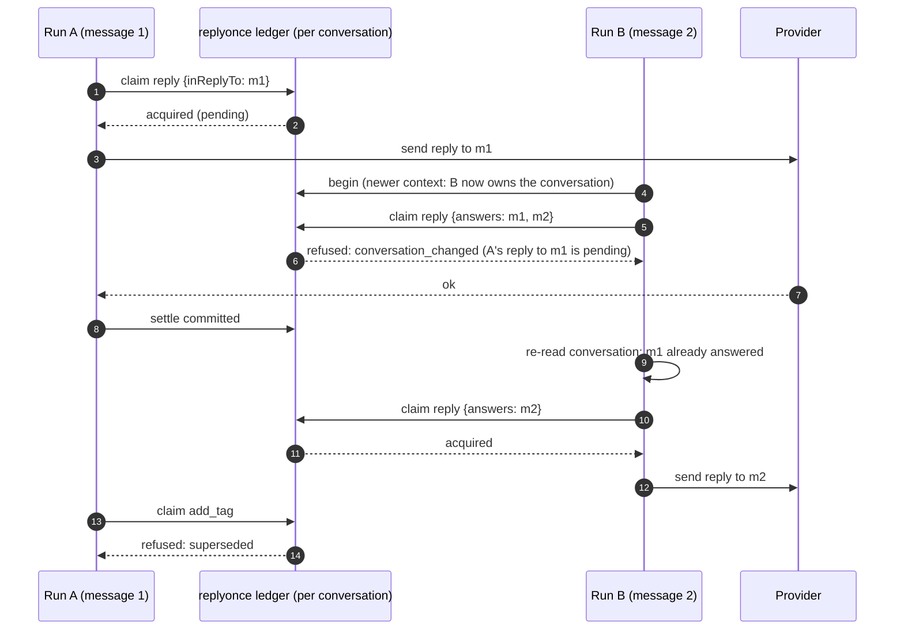
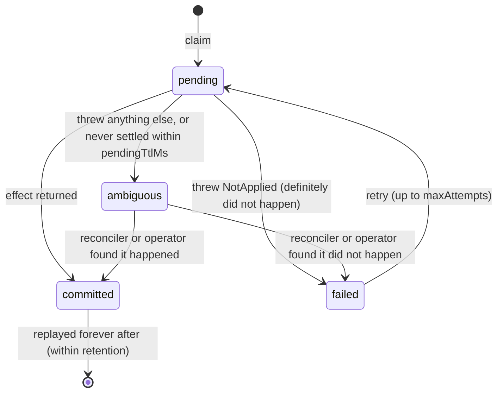

# replyonce

**Stop your agent from replying, refunding or ticketing twice.**

[](https://github.com/shmindmaster/replyonce/actions/workflows/ci.yml)
[](LICENSE)

Agents retry tool calls. Queues redeliver jobs. Webhooks arrive twice. A deploy kills a
run halfway, and a customer's second message starts a new run while the first one is still
answering. The customer gets two replies, or two refunds, or two tickets, and the agent
reports success.

replyonce sits between your agent and its side effects:

- **Each effect runs at most once per business identity**: the order being refunded, or
  the message being answered. It is never keyed on the model's wording or its tool-call id.
- **Stale runs cannot write.** Every run on a conversation holds a fencing token. Once a
  newer run, or a redelivery of the same job, takes over, the old run's writes are refused.
- **A run is told when the conversation changed under it.** If another run's reply is in
  flight, or landed after this run read the conversation, the write is refused with what
  happened, so the agent can re-read and decide.
- **Unknown outcomes are not retried blindly.** A timeout after the provider may have acted
  is recorded as `ambiguous`. A reconciler you supply checks what happened, or a human resolves it.

Zero runtime dependencies. Node 18+. Stores for memory, Postgres and Redis. Adapters for
tool-calling loops (OpenAI and Anthropic shapes), webhook handlers and BullMQ workers.
A [Python port](python/) (asyncio, 3.10+) uses the same state machine and state format,
so Node and Python workers can share one store. CI checks that both ways.

```text
$ npx replyonce demo
replyonce demo: 100 simulated support conversations under injected faults
  without: workerCrash=9, duplicateDelivery=14, customerBurst=22, timeoutAfterSend=29, timeoutBeforeSend=15
  with:    workerCrash=10, duplicateDelivery=15, customerBurst=22, timeoutAfterSend=18, timeoutBeforeSend=12

                   messages replies duplicates  unanswered
  without               122     174         74           0
  with replyonce        122     120          0           0

  No customer message was answered twice with replyonce.
```

The demo is a simulation, so the counts vary from run to run. CI runs it on every push
and fails if a single duplicate gets through.

## 30-second quickstart

```sh
npm install replyonce
```

```ts
import { createReplyOnce, MemoryStore } from 'replyonce';

const ro = createReplyOnce({ store: new MemoryStore() }); // PostgresStore / RedisStore in production

let refundsIssued = 0;
const refund = () =>
  ro.once({ scope: 'order-A-1001', intent: 'refund', payload: { order: 'A-1001', cents: 2500 } }, async (ctx) => {
    // Your provider call goes here; pass ctx.idempotencyKey if it accepts one.
    refundsIssued++;
    return { refundId: 're_1' };
  });

// Three workers race, then a late retry arrives.
const raced = await Promise.all([refund(), refund(), refund()]);
const late = await refund();

console.log(raced.map((r) => r.status)); // [ 'executed', 'in_flight', 'in_flight' ]
console.log(late.status, late.ok && late.value); // replayed { refundId: 're_1' }
console.log(refundsIssued); // 1
```

For a conversational agent, open a **run** per unit of work (one inbound message, one queue
job) and send every customer-visible write through it:

```ts
const run = await ro.begin(conversationId, {
  runId: job.id,              // the same id on redelivery resumes the same run
  contextAt: job.data.readAt, // when this run's view of the conversation was captured
});
if (!run.canWrite) return;    // a newer run owns the conversation, or this job already finished

const r = await run.once('reply', { inReplyTo: inboundMessageId }, () => chat.send(conversationId, text), {
  summary: text, // other runs see this if they conflict with it
});

if (r.status === 'refused' && r.reason === 'conversation_changed') {
  // r.conflicts says what another run did. Re-read the conversation and decide again;
  // calling run.once again is allowed once you have.
}
await run.end();
```

## How it works



Each **scope** (usually a conversation) has one small state document holding its runs and
its effect ledger. Every decision is one atomic read-modify-write of that document: no lock
in memory, a row lock (`SELECT … FOR UPDATE`) in Postgres, and a compare-and-set Lua script
in Redis. All the logic is a pure state machine in [`src/logic.ts`](src/logic.ts), so every
store behaves the same way, and the same test suite runs against all three.

Each ledger entry moves through these states:



A claim is decided in this order:

1. **Already done?** `committed` replays the stored result. `pending` reports `in_flight`,
   or waits if you pass `wait`. `ambiguous` calls your reconciler, otherwise reports `ambiguous`.
2. **May this run write?** It is refused if it was cancelled or has ended, or if its
   fencing token is stale: a newer run took the scope, or a later delivery took the run
   (`superseded`). A newer run that ended without writing does not count.
3. **Has the conversation changed?** Another run's write that is still pending, or that
   landed after this run last looked, is a conflict. The refusal records an *ack*, so the
   run's next attempt (after it re-reads) can go through.
4. **Claim**: write a `pending` entry and run the effect.

"Last looked" uses a logical sequence number per scope, not wall-clock time, so two writes
in the same millisecond are still ordered. `contextAt` moves the starting point back to
when the run's input was captured, which closes the gap between "webhook payload
snapshotted" and "worker started".

## API

```ts
createReplyOnce(options): ReplyOnce
```

| Option | Default | Meaning |
|---|---|---|
| `store` | required | `MemoryStore`, `PostgresStore`, `RedisStore`, or your own `Store` |
| `pendingTtlMs` | 15 min | After this, an unsettled claim is treated as abandoned (`ambiguous`). Must exceed your slowest effect. |
| `maxAttempts` | 3 | Attempts per key, counting only attempts known not to have applied |
| `leaseTtlMs` | 60 s | Run lease, renewed on every claim and `heartbeat()` |
| `retentionMs` | 7 days | How long settled effects and ended runs are remembered |
| `classifyError` | see below | `(err) => 'not_applied' \| 'ambiguous'` |
| `reconcile` | none | `async (entry) => ({ outcome: 'committed' \| 'not_applied' \| 'unknown' })` |
| `onEvent` | none | Observer for `claimed`, `committed`, `replayed`, `refused`, `ambiguous` and other events (logs, metrics, OpenTelemetry) |

By default only `NotApplied` (or any error with `replyonce: 'not_applied'`) counts as
"did not happen". Every other error is `ambiguous`, because a timeout or reset says
nothing about whether the provider acted. Throw `new NotApplied(...)` for failures you
know happened before the write, such as validation or a 4xx from a provider that is
atomic per request.

| Method | |
|---|---|
| `ro.once(key, effect, opts?)` | Run `effect` at most once. `key` is a string (its own scope) or `{ scope, intent, payload }`. |
| `ro.begin(scope, { runId?, mode?, contextAt?, leaseTtlMs? })` | Start or resume a run. `mode: 'supersede'` (default, newest context wins) or `'exclusive'` (one lease holder at a time). |
| `run.once(intent, payload, effect, opts?)` | Fenced, conversation-aware `once`. Options: `summary`, `conflict: 'any' \| 'same-intent' \| 'none'`, `ack`, `wait`. |
| `run.check(intent, payload)` / `ro.check(key)` | "Was this already done?" Returns `{ done, status, entry }` without side effects. |
| `run.heartbeat()` | Renew the lease. `false` means stop. |
| `run.end(reason?)` / `ro.cancel(scope, runId)` | Finish or cancel a run. |
| `ro.history(scope)` | The scope's ledger, oldest first. |
| `ro.resolve(key, { outcome })` | Record what an operator found for an ambiguous effect. |
| `unwrap(result)` | The value, or throw `ReplyOnceError`. |

The effect receives `ctx`: `key`, `attempt`, `idempotencyKey` (stable across attempts and
workers; pass it to providers that support one), `fencingToken`, and `signal`, which aborts
when the claim would be treated as abandoned.

Every call returns a result instead of throwing (store outages do throw):

| `status` | Meaning | What to do |
|---|---|---|
| `executed` | Ran now | Use `value` |
| `replayed` | Already done earlier | Use the stored `value`; do not tell the customer twice |
| `in_flight` | Another worker is doing it right now | Nothing, or pass `wait` |
| `ambiguous` | May or may not have happened | Reconcile or escalate; never repeat blindly |
| `failed` | Known not to have happened | Retry if `retryable` |
| `refused` | `superseded`, `run_cancelled`, `run_ended`, `busy`, `conversation_changed`, `exhausted` | See `reason` |

## Adapters

```ts
import { guardTool, checkTool, dispatchTool, toOpenAITool, toAnthropicTool,
         webhookOnce, httpStatusFor, onceProcessor } from 'replyonce/adapters';
```

**Tool-calling loops.** `guardTool({ name, description, parameters, identity, execute })` wraps
a side-effecting tool. `identity(args)` picks the fields that make two calls the same action.
`tool.call(run, args)` returns a model-facing result: `ok`, `message`, `terminal` (stop the
loop) and `retryable`. `checkTool(tools)` adds a read-only `check_already_done` tool the model
can call first. `toOpenAITool` (Chat Completions or Responses) and `toAnthropicTool` produce
the provider's tool schema. See [`examples/agent-loop.ts`](examples/agent-loop.ts).

**Webhooks.** `webhookOnce(ro, { scope, eventId }, handler)` returns the handler's result
plus a suggested HTTP status. A concurrent duplicate gets `503` with `Retry-After`, so the
provider keeps retrying if the first delivery dies. A handled event gets `200`, and so does
an ambiguous one, because redelivery cannot resolve it. See
[`examples/webhook-server.ts`](examples/webhook-server.ts).

**BullMQ.** `onceProcessor(ro, { scope: (job) => job.data.conversationId }, processor)` makes
each job a run keyed by queue name and job id. Retries and stalled-job redelivery resume the same run;
completed `run.once` calls replay and are not redone. `onRedeliveredAfterWrite: 'skip'`
refuses to re-run a job that already wrote, for processors whose effect identities are not
deterministic. See [`examples/bullmq-worker.ts`](examples/bullmq-worker.ts).

## Stores

```ts
import { PostgresStore } from 'replyonce/postgres';
const store = new PostgresStore({ pool: new pg.Pool({ connectionString }) });
await store.migrate(); // or run postgresSchemaSql() in your migration tool

import { RedisStore } from 'replyonce/redis';
const store = new RedisStore({ client: new Redis(url) }); // ioredis
```

Both take a structural client (`pg.Pool`-like or `eval`-capable), so replyonce has no
runtime dependencies. To use node-redis, adapt `eval` as shown in the `RedisStore` docs.
To write your own store, implement `transact(scope, fn)` atomically and `read(scope)`.

## Guarantees

With a shared store and every side effect going through replyonce:

1. **No concurrent attempts.** For a key, a new attempt starts only when no attempt is
   pending and every earlier attempt is known not to have applied.
2. **Committed means final.** A committed effect is not run again within `retentionMs`;
   later calls replay its stored result.
3. **Fencing.** A run whose token is stale (a newer run on the scope, a later delivery of
   the same job, or an exclusive lease taken over after expiry) cannot claim new writes.
4. **No writing from a stale view.** A run's claim is refused with `conversation_changed`
   while another run's write on the scope is pending, or if one landed (or turned
   ambiguous) after the run's context was read.
5. **Ambiguity is preserved.** An outcome that is not known is never turned into a retry
   unless your reconciler or an operator says it did not happen.

These properties are exercised by race tests (parallel workers, redelivery storms with
crashing workers, concurrent runs on one conversation) and by the chaos demo, against all
three stores, in CI.

## Limits

- **Not exactly-once delivery.** If the provider acts and the worker dies before
  recording it, replyonce knows only that the outcome is ambiguous. Exactly-once needs a
  provider that honours `ctx.idempotencyKey`, or a reconciler that can look the effect up.
- **Fencing happens at claim time.** A write already sent when its run is superseded is
  not recalled. Pass `ctx.fencingToken` or `ctx.signal` downstream if the target can check them.
- **`pendingTtlMs` must exceed your slowest effect.** Past it, a claim is treated as
  abandoned. If a reconciler then wrongly says "not applied", a retry can duplicate. A late
  settle is flagged as `lateSettle: true` and emits a `late_settle` event.
- **Keys are only as good as their identity.** Hash model-generated text into a key and a
  reworded reply is a new key. The conversation fence still catches a reworded repeat when
  the earlier write landed after the run's context was read, whether by another run or by
  an earlier delivery of the same job. It does not catch a run that already saw the
  earlier write and repeats it anyway, or one delivery doing the same intent twice.
- **Clocks.** Leases, TTLs and `contextAt` use each caller's clock. Keep clock skew well
  below those durations. Ordering within a scope uses a logical counter.
- **One document per scope.** Very long-lived scopes with thousands of effects get slower.
  Use narrower scopes or a shorter `retentionMs`. Ambiguous effects are kept until resolved.
- **Redis** gives the same logic, with Redis durability: asynchronous replication can lose
  acknowledged writes on failover, and an expired key (`keyTtlMs`, default 30 days) is
  forgotten. Prefer Postgres when that matters. Under extreme contention on a single scope,
  `RedisStore` can throw `StoreContentionError`.
- **Not a workflow engine or an outbox relay.** There is no background reconciler: ambiguous
  effects are reconciled the next time the key is claimed, or by `resolve()`.
- `MemoryStore` is per process: for tests, demos and single-instance services.

## Python

```sh
pip install replyonce        # or "replyonce[postgres]" / "replyonce[redis]"
replyonce demo
```

```python
from replyonce import Key, MemoryStore, ReplyOnce

ro = ReplyOnce(MemoryStore())
result = await ro.once(Key("order-A-1001", "refund", {"order": "A-1001", "cents": 2500}), issue_refund)
```

The API mirrors the TypeScript one in snake_case (`ro.begin(scope, run_id=..., context_at=...)`,
`run.once(intent, payload, effect)`). Keys hash identically, and the Postgres table and
Redis layout are the same. See [python/README.md](python/README.md).

## Prior art

Idempotency keys as payment APIs use them, fencing tokens for distributed locks, the
transactional outbox, and at-least-once delivery with idempotent consumers. replyonce
applies them to the conversational case those patterns do not cover on their own: a newer
message supersedes an older run, a redelivered job must not answer again, and a reworded
reply is still the same reply.

## Contributing and security

See [CONTRIBUTING.md](CONTRIBUTING.md) and [SECURITY.md](SECURITY.md). Licensed under
[Apache-2.0](LICENSE).
